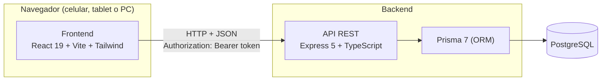
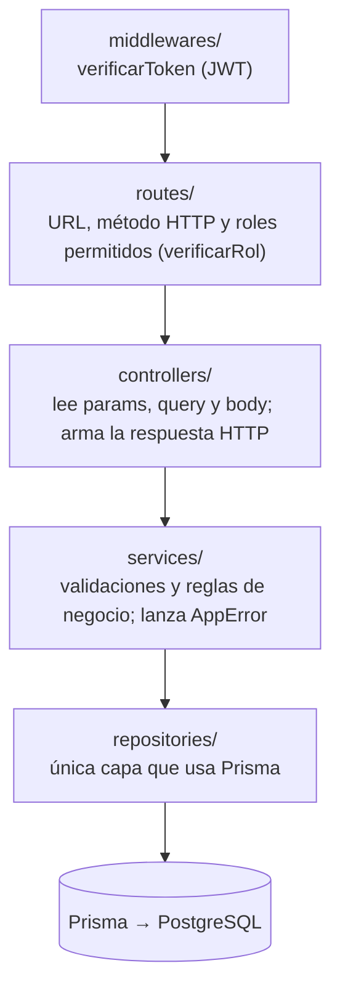
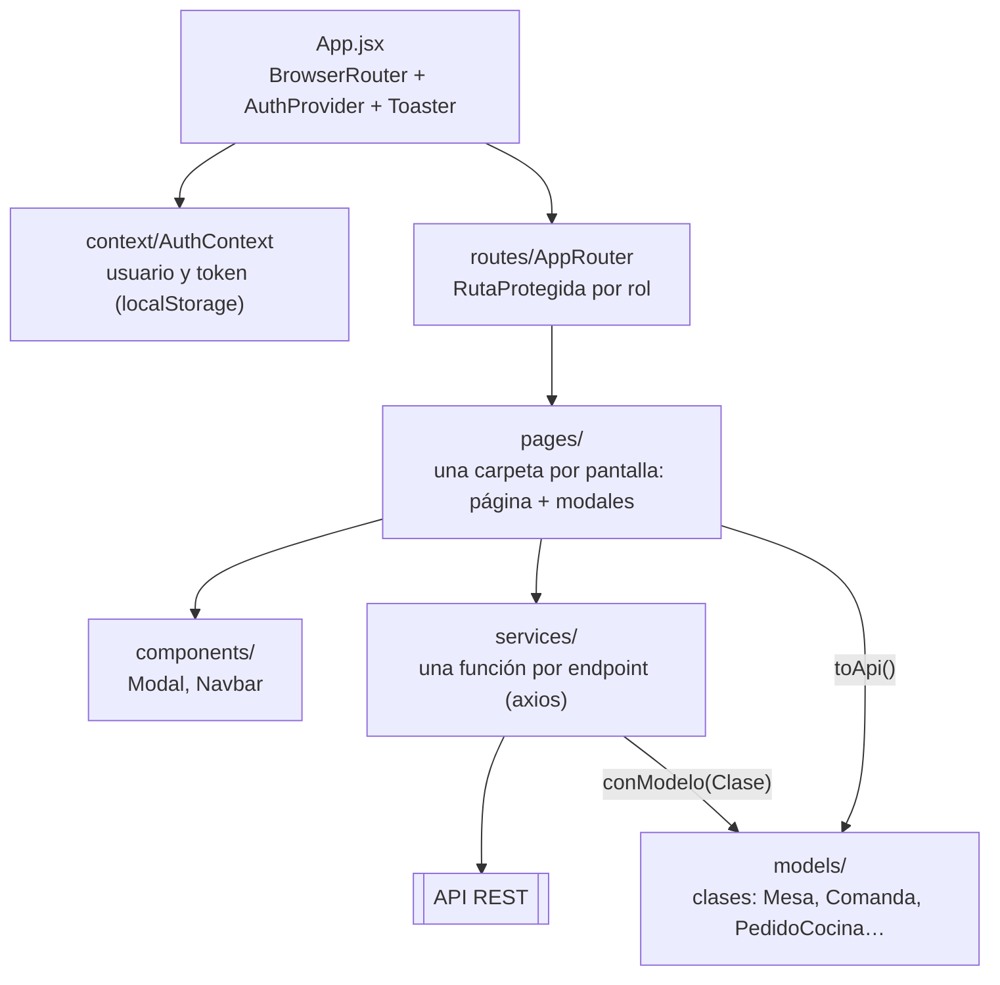
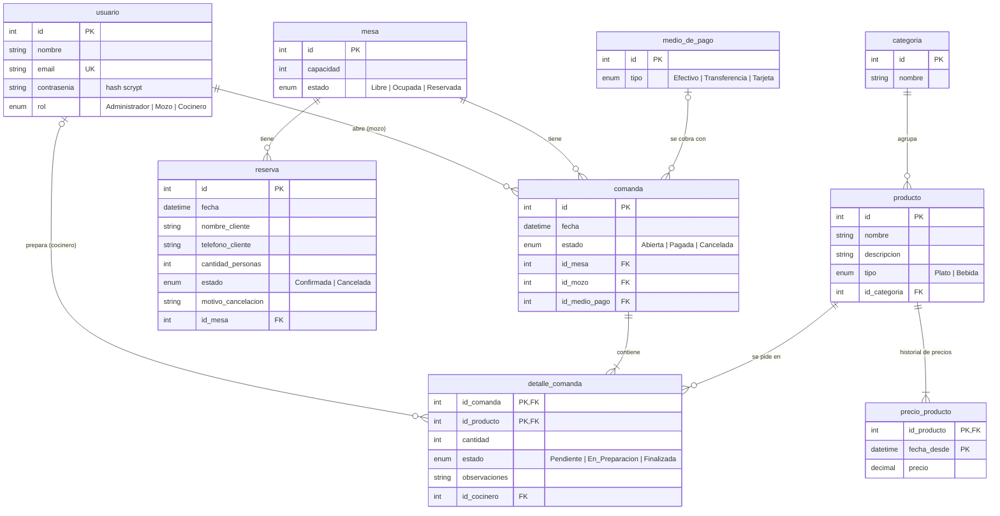
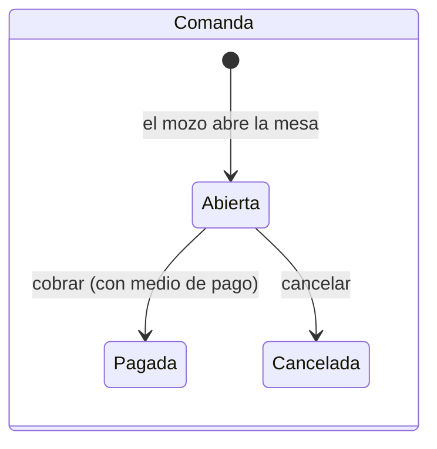
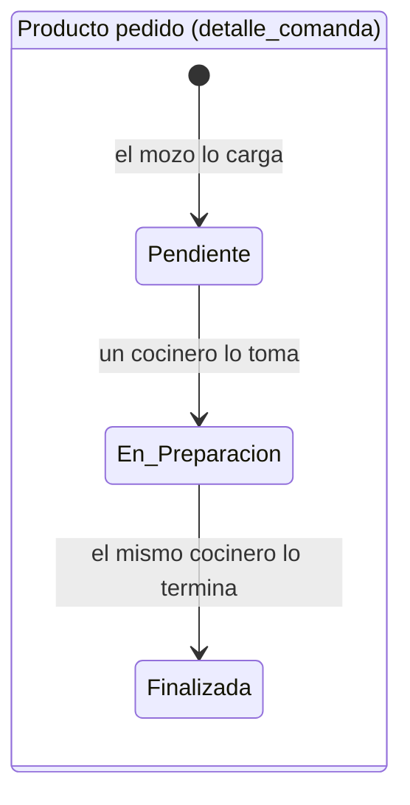
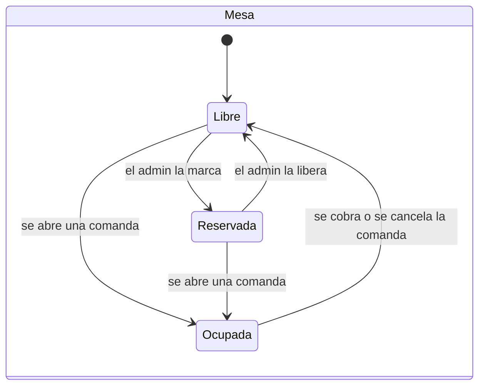
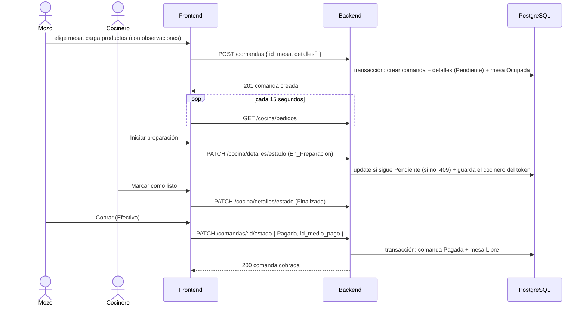

# Arquitectura y modelo de datos

## Vista general

Frontend y backend son dos aplicaciones independientes que se comunican solo por la API REST (JSON + token JWT).

## Backend en capas

Cada módulo (mesas, reservas, comandas, cocina, etc.) tiene las mismas cuatro capas. Ninguna capa se saltea a la de abajo.

- **Errores:** los servicios lanzan `AppError(mensaje, código)`; los controladores lo convierten en `{ "message": "..." }` con el código HTTP. Un JSON mal formado devuelve 400 y una ruta inexistente 404.
- **Transacciones:** abrir una comanda (comanda + productos + mesa Ocupada) y cerrarla (estado + medio de pago + mesa Libre) se hacen con `prisma.$transaction`: o se guarda todo o nada.
- **Concurrencia en cocina:** el cambio de estado de un plato usa `updateMany` condicionado al estado actual; si dos cocineros lo tocan a la vez, el segundo recibe 409.

## Frontend

- **Servicios:** `services/api.js` agrega el token a cada pedido y, si el backend responde 401, cierra la sesión.
- **Modelos:** cada respuesta se convierte en una instancia de su clase (`Mesa.desdeApi(json)`, patrón Factory Method) y los formularios arman el body con `toApi()`.
- **Estilos:** Tailwind CSS v4, mobile-first (breakpoints `sm` 640px, `md` 768px, `lg` 1024px).

## Modelo de datos implementado

**Diferencias con el DER conceptual de la propuesta** ([der.webp](der.webp)):

- `estadoReserva` y `estado-comandaDetalle` pasaron a ser **enums** de PostgreSQL: son valores fijos que no administra el usuario.
- `plato` pasó a llamarse `producto` y tiene un `tipo` (Plato o Bebida), para poder cargar también bebidas.
- Los roles (mozo, administrador, cocinero) son un enum `rol` dentro de `usuario` en lugar de subtipos.
- El total de la comanda y los subtotales no se guardan: se calculan con el **precio vigente** de cada producto a la fecha de la comanda (`precio_producto` guarda el historial).
- Se agregó `observaciones` a `detalle_comanda` para las aclaraciones a la cocina.

## Ciclos de vida

## Secuencia del circuito principal

