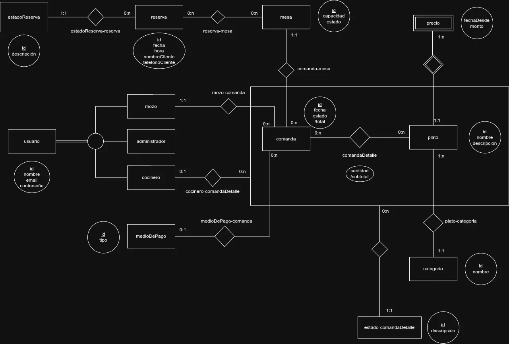

# Propuesta TP DSW

## Grupo
### Integrantes

* 54310 - Cataldi, Donato
* 54152 - Vada, Gaspar Ignacio
* 55264 - Curti, Tomas Andres
* 55220 - Acosta, Ismael Fabricio

### Repositorios
* [fullstack app (monorepo: `backend/` + `frontend/`)](https://github.com/CataldiDonato/TP-Desarrollo-de-software)

*Nota*: el backend y el frontend se desarrollaron primero en dos repos separados ([backend](https://github.com/CataldiDonato/TP-Desarrollo-de-software-Backend), [frontend](https://github.com/CataldiDonato/TP-Desarrollo-de-software-Frontend)) y después se unificaron en este fork conservando todo su historial de commits.

### Pull Requests
* [PR de entrega a utnfrrodsw/tp](https://github.com/utnfrrodsw/tp/pulls) *(completar con el link del PR una vez abierto)*
* PRs internos de desarrollo: [backend #1 — módulo de salón (mesas y reservas)](https://github.com/CataldiDonato/TP-Desarrollo-de-software-Backend/pull/1) · [frontend #1 — dashboard, usuarios y cocina](https://github.com/CataldiDonato/TP-Desarrollo-de-software-Frontend/pull/1)

## Tema
### Descripción
RestoFlow es una plataforma full-stack para la gestión interna de establecimientos gastronómicos que digitaliza el ciclo completo del salón, conectando a mozos, cocina y caja para optimizar el servicio y el control de ventas.

### Modelo
DER conceptual de la propuesta:

El modelo implementado (diagrama en Mermaid y diferencias con el DER conceptual) está en [docs/arquitectura.md](docs/arquitectura.md#modelo-de-datos-implementado).

### Tecnologías
* **Backend:** Node.js + **TypeScript** (superset de JavaScript, en modo `strict`), Express 5, Prisma 7 (ORM) y PostgreSQL.
* **Frontend:** React 19 + Vite, Tailwind CSS 4, React Router y Axios.
* **Tests:** `node:test` (backend), Vitest + Testing Library y Playwright (frontend).

## Alcance Funcional

### Alcance Mínimo

Regularidad:
|Req|Detalle|
|:-|:-|
|CRUD simple|1. CRUD Categoría de producto 2. CRUD Mesa 3. CRUD Medio de pago 4. CRUD Usuario (Administrador, Mozo, Cocinero)|
|CRUD dependiente|1. CRUD Producto {depende de} Categoría (con historial de precios) 2. CRUD Reserva {depende de} Mesa 3. CRUD Comanda {depende de} Mesa, Usuario (mozo) y Producto|
|Listado + detalle| 1. Pantalla de Cocina (KDS) filtrada por estado (pendiente / en preparación), agrupada por comanda, muestra mesa, productos, cantidades y observaciones => detalle de la comanda con mozo, avance y cocinero de cada producto 2. Listado de mesas filtrado por estado (libre / ocupada / reservada), muestra número, capacidad y estado => detalle con la comanda activa (mozo y productos) y las próximas reservas|
|CUU/Epic|1. Apertura de mesa y carga del pedido por el mozo 2. Gestión de reserva de mesa con asignación según disponibilidad|

Adicionales para Aprobación
|Req|Detalle|
|:-|:-|
|CRUD |1. CRUD Categoría 2. CRUD Mesa 3. CRUD Medio de pago 4. CRUD Usuario 5. CRUD Producto (el precio se administra desde el producto y queda historial) 6. CRUD Reserva 7. CRUD Comanda (alta, consulta, modificación de productos, cobro y cancelación)|
|CUU/Epic|1. Apertura de mesa y carga del pedido por el mozo 2. Gestión de reserva de mesa con asignación según disponibilidad 3. Ciclo de cocina: recepción del pedido, preparación y actualización del estado de cada producto 4. Cierre de mesa: cobro con medio de pago y liberación de la mesa|

Los CUU 1, 3 y 4 están encadenados: la comanda que abre el mozo (1) es la que prepara la cocina (3) y la que después se cobra (4).

### Alcance Adicional Voluntario

|Req|Detalle|
|:-|:-|
|Listados |1. Listado de comandas filtrado por estado (abiertas / pagadas / canceladas), muestra mesa, mozo, medio de pago y total => detalle con productos, precios y acciones de cobro 2. Listado de reservas filtrado por cliente y por día 3. Listado de productos filtrado por nombre y categoría => detalle con historial de precios|
|CUU/Epic|1. Dashboard del administrador: mesas ocupadas, ventas del día, pedidos en cocina y próximas reservas|
|Otros|1. Actualización automática de la pantalla de cocina (polling cada 15 segundos) 2. Control de concurrencia: dos cocineros no pueden tomar el mismo plato|
